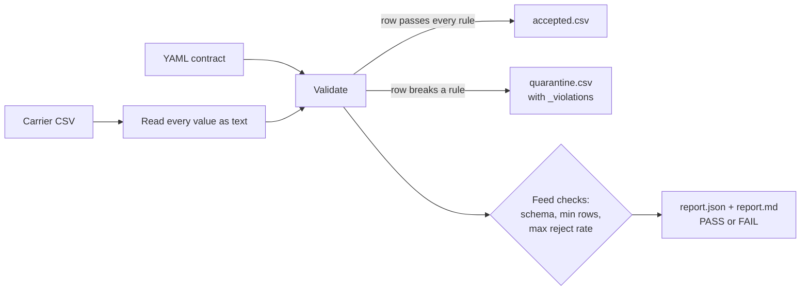

# Carrier Feed Contract Checker

Checks the daily shipment status file each carrier sends against a written data contract, splits it into rows that are safe to load and rows to send back, and writes a short quality report for the carrier and the operations team.

## The problem

Transport teams receive a shipment status feed from every carrier, usually a CSV dropped once or several times a day. These files feed delivery KPIs, freight cost reports and customer updates. They break in quiet ways: a tracking ID typed in lower case, a status like `DLVRD` that is not in the agreed list, a negative weight, a shipment marked delivered before it was picked up, the same tracking ID sent twice. If the file is loaded as it is, those rows distort on-time and cost numbers, and nobody notices until a report looks wrong.

A data contract writes down what both sides agreed the file looks like. This project turns that agreement into a check that runs before the load: good rows go through, bad rows are quarantined with the exact rule they broke, and the whole file is rejected if too much of it is bad.

## How it works



1. **Contract** (`contracts/carrier_shipment_status.yaml`). Each column has a type (`string`, `int`, `float`, `datetime`) and optional `required`, `allowed`, `regex`, `min`, `max`, `unique` and `format`. Cross-column rules cover `compare` (for example `delivered_at >= picked_up_at`) and `required_if` (for example `delivered_at` is required when `status` is `DELIVERED`). Feed-level limits set the minimum row count and the highest reject rate allowed. The contract is checked when it is loaded, so a typo (unknown column, bad regex, `min` greater than `max`, a misspelt key such as `rule:` or `max_reject_rates:`, or a rule name that repeats another rule or a column check such as `eta.required`) fails straight away instead of silently passing every row.
2. **Read.** The CSV is read with every value kept as a string, so nothing is coerced before it is checked. Frames that arrive from elsewhere with `NaN` or `None` are normalised to empty strings first.
3. **Validate.** Each column is parsed once to its contract type; values that do not parse fail the type rule. Each row collects the names of every rule it broke.
4. **Split and report.** Clean rows go to `accepted.csv`; the rest go to `quarantine.csv` with a `_violations` column. The feed passes only if all contract columns are present, it has enough rows and the reject rate is within the limit. The CLI exits with `0` for pass, `1` for fail and `2` if the contract or feed could not be read, so it can gate a scheduled load.

## How to run

```bash
cd projects/carrier-feed-contract-checker
python -m venv .venv && source .venv/bin/activate
pip install -e ".[dev]"
pytest -q

# check the shipped sample feed
carrier-feed-check check data/sample_feed.csv --contract contracts/carrier_shipment_status.yaml --out-dir out

# make a new synthetic feed (add --keep-labels to keep the ground-truth _defect column)
carrier-feed-check generate --out feeds/bad.csv --rows 2000 --defect-rate 0.2 --seed 7
carrier-feed-check check feeds/bad.csv --contract contracts/carrier_shipment_status.yaml --out-dir out-bad
```

## Results

From a run on 17 Oct 2026. Tests: `68 passed`.

**Shipped sample feed** (500 rows):

```
PASS: 462 accepted, 38 quarantined of 500 rows (7.6%)
Outputs written to out/
```

| Rule | Column | Rows |
|---|---|---:|
| tracking_id.regex | tracking_id | 7 |
| weight_kg.min | weight_kg | 7 |
| status.allowed | status | 6 |
| tracking_id.unique | tracking_id | 6 |
| delivered_after_pickup | delivered_at | 5 |
| delivered_needs_timestamp | delivered_at | 4 |
| tracking_id.required | tracking_id | 3 |

**A bad day** (2,000 rows, 20% defect rate): the feed is rejected as a whole and the command exits with code 1.

```
Wrote 2000 rows to feeds/bad.csv (424 with injected defects)
FAIL: 1576 accepted, 424 quarantined of 2000 rows (21.2%)
  failed feed.max_reject_rate: 21.2% rejected (limit 10%)
```

**Against ground truth** (5,000 rows, seed 42, generated with `--keep-labels`): all 428 rows with an injected defect were quarantined and none of the 4,572 clean rows were. By defect type: bad tracking format 68, missing delivered timestamp 71, unknown status 64, delivered before pickup 60, duplicate tracking ID 60, negative weight 55, missing tracking ID 50.

That perfect score says the rules cover the defects the generator injects; it does not say real carrier files would score the same. Real feeds will have problems nobody has written a rule for yet, which is why the reject-rate limit exists as a backstop.

## Design decisions

- **Contract as YAML, not code.** The file is something an analyst and a carrier can read and agree on. Adding a column or tightening a rule is a reviewed change to one file.
- **Quarantine rows, not the whole file, unless the file is broadly bad.** One wrong row should not hold up 499 good ones, but a feed where a fifth of the rows are broken usually means something upstream changed, and loading the "good" part would hide that.
- **Strings first.** Reading everything as text and parsing per the contract means `"12.5kg"` fails as a bad float rather than being dropped or guessed at, and an `int` column rejects `3.5` while still accepting `3.0`, which many exports write. Values that parse to infinity (`inf`, `Infinity`, `1e400`) also fail the type check, so a column with only a `min`, such as `freight_charge_inr`, cannot load an infinite charge.
- **Keep the first of a duplicate.** For `unique` columns the first row with a value is accepted and later repeats are quarantined, matching how a loader would treat a resend.
- **Extra columns are reported, not rejected.** Carriers add columns without warning; the check notes them in the report and ignores them.
- **Plain pandas.** Feeds are thousands to a few hundred thousand rows a day; validating a 200,000-row synthetic feed took about 0.8 seconds in the run above (reading and checking, not writing outputs). The only dependencies are pandas and PyYAML.

## What it does not do

No database connection, scheduling or notifications; the CLI exit code is meant to be wired into whatever already runs the daily load. Only CSV input is supported.

## Data

All data here is synthetic. `generate.py` builds shipment rows for five Indian carriers and ten cities with random weights, charges and timestamps, then injects seven defect types at a set rate. Carrier names are used only as labels; nothing comes from a real carrier feed.
