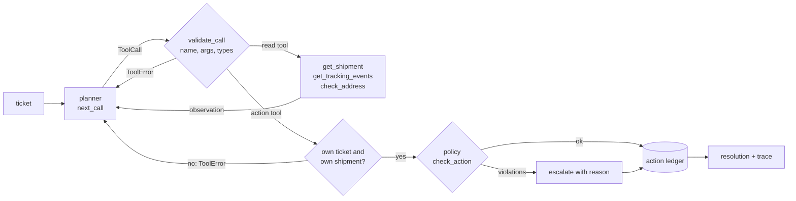

# Delivery Exception Triage Agent

A tool-calling agent for delivery exception tickets ("where is my parcel", "it arrived broken", "tracking says delivered but I have nothing"). It looks up the shipment through typed tools, decides on one action, and every action passes policy guardrails before it runs. An evaluation harness scores a planner on labelled tickets: the right action, the right amount, date or escalation reason, and the right tools called.

All data in this project is synthetic. Shipments, scan histories and customer messages are generated from a fixed seed by the code in `src/`; no real customer, carrier or order is used. No model or network access is needed: the planner shipped here is a rule-based baseline, and the agent loop is built so a model-backed planner can be plugged in behind the same interface.

## The problem

A dispatch support desk works through a steady stream of exception tickets. For each one somebody has to read the message, look up the shipment and its scans, and pick an action: send a new ETA, reship a lost parcel, book a redelivery, ask for a corrected address, refund damaged goods, close the ticket, or hand it to a supervisor. The desk has rules: refunds above ₹5,000 need a supervisor, a parcel only counts as lost after 72 hours without a scan, a redelivery must be booked within the next seven days, and a shipment is compensated at most once.

Teams that want to automate part of this with an LLM agent usually start with the prompt. The parts that decide whether it is safe are elsewhere:

- a tool layer that rejects a malformed call instead of running it, and tells the agent why
- guardrails that stop an action the policy does not allow, whatever the agent decided
- a way to measure, ticket by ticket, whether the agent did the right thing

This project builds those three parts and a baseline planner to exercise them.

## How it works



1. **Tools** (`tools.py`). Ten tools with typed argument specs: three read tools and seven action tools. `validate_call` rejects unknown tools, missing or extra arguments, wrong types, NaN amounts and bad dates with a `ToolError`. The agent loop returns that error to the planner as an observation, the way a tool-calling API does, and the run continues. Action tools can only act on the ticket being handled and its own shipment; read tools may look up any shipment.
2. **Guardrails** (`policy.py`, thresholds in `policy_rules.py`). Every action except `escalate` is checked before it runs. Examples: a refund only for a delivered shipment, never above the declared value, and not above the auto-approval limit; a reship only for an in-transit shipment silent for more than 72 hours, and never for one with no scans at all; no ETA reply for a shipment that is already treated as lost; a redelivery only after a failed attempt, to a valid address, within the booking window; no second compensation for the same shipment, tracked in a ledger shared across tickets. The generator labels tickets from the same thresholds, so the labels and the checks cannot drift apart.
3. **Agent loop** (`agent.py`). Asks the planner for the next call, runs it, appends the step to the trace, and stops when an action runs. Three safety nets make sure every ticket ends with exactly one recorded action: a blocked action becomes an escalation carrying the violation, a planner that raises or returns something other than a `ToolCall` is escalated as `planner_error`, and a run that hits the step budget (8 by default) is escalated as `step_budget_exhausted`. The fallback escalation is part of the trace, so the trace always agrees with the ledger.
4. **Baseline planner** (`planner.py`). Reads the shipment, then the scans, then the address where needed, and decides from the shipment state plus the intent of the message. Intent detection works on whole words, corrects one swapped, missing or extra letter in key words of five letters or more ("recieved", "htanks"), and ignores negated damage words ("no damage, just late"). It does not correct substituted letters, because that turns real words into key words ("broker" into "broken").
5. **Evaluation** (`evaluate.py`, `report.py`). Runs a planner over labelled tickets with one shared ledger and reports action accuracy, resolution accuracy (action plus refund amount, redelivery date or escalation reason), tool-call precision and recall against the expected tool sequence, tool errors, policy blocks, planner errors and budget exhaustions, per-scenario accuracy, a confusion table of wrong actions and every mistake with its message.

## How to run it

Requires Python 3.10 or newer.

```bash
cd projects/delivery-exception-triage-agent
python -m venv .venv && source .venv/bin/activate
pip install -e ".[dev]"
pytest -q

triage-generate --out data --tickets 300 --seed 7   # rewrites the sample dataset (already committed)
triage-eval --data data --out reports                # writes reports/evaluation.json and .md
triage-run TKT-00108                                 # one ticket's trace, step by step
```

`triage-run` output for a ticket with a typo in it:

```text
TKT-00108 (SHP-00108): Recieved SHP-00108 smashed, totally unusable.
  1. get_shipment({"shipment_id": "SHP-00108"}) -> {"found": true, "shipment_id": "SHP-00108", "status": "delivered", "carrier": "BlueLine", "destination_city": "Dehradun", "promised_date": "2026-10-28", "declared_value_inr": 1249.57}
  2. issue_refund({"shipment_id": "SHP-00108", "amount_inr": 1249.57, "reason": "damaged"}) -> {"executed": true, "action": "issue_refund"}
resolution: issue_refund (1,249.57 INR)
expected:   issue_refund (1,249.57 INR)
```

## Results

The sample dataset (`data/`) has 300 tickets over 284 shipments across ten scenarios, generated with seed 7. About 15% of messages have two adjacent letters swapped.

| Run | Tickets | Action accuracy | Resolution accuracy | Tool precision | Tool recall |
|---|---:|---:|---:|---:|---:|
| Day 2 baseline, sample set (seed 7) | 300 | 97.7% | 95.3% | 99.2% | 99.0% |
| Final planner, sample set (seed 7) | 300 | 100.0% | 100.0% | 100.0% | 100.0% |
| Final planner, fresh seed 11 | 1,000 | 100.0% | 99.6% | 100.0% | 99.9% |
| Final planner, fresh seed 23 | 1,000 | 100.0% | 99.5% | 100.0% | 99.8% |

All runs had 0 tool errors, 0 policy blocks, 0 planner errors and 0 step-budget exhaustions. The full report for the sample set is in [`reports/evaluation.md`](reports/evaluation.md).

How to read these numbers:

- **The sample-set score is an upper bound.** The day 2 report listed 14 mistakes, all wording: "smashed" was not a damage word, and typos such as "erceived" and "htanks" were missed. The day 3 changes were made with those misses in view, and the generator uses the same message templates for every seed, so 100% on seed 7 mainly shows the misses were fixed.
- **Fresh seeds expose the next gap.** On seeds 11 and 23 every action is still right, but 9 of 2,000 tickets were escalated with the wrong reason (`unclear_request` instead of `delivery_dispute`). Each one has a typo in a word the planner does not correct ("neevr", "nohting", "oNbody"). These were left unfixed on purpose, so the numbers above stay a fair check.
- **Wording the generator never produces is the real test.** `tests/test_heldout_wording.py` holds 20 messages written separately from the templates and not used for tuning. The planner gets **17 of 20** right. It misses "have not received it" and "it is not here" (not covered by the not-received patterns) and "great service" (praise without a thank-you word). These three are kept as strict expected failures, so fixing one changes the test result.
- **The guardrails are not exercised by the baseline.** The rule-based planner never attempts a blocked action, so policy blocks are 0. The guardrails are covered by tests that call the tools directly or drive the agent with scripted planners making the mistakes a model could make: acting on another customer's shipment, refunding above the limit, reshipping a parcel with no scans, promising an ETA on a lost parcel, looping until the step budget runs out, raising mid-ticket.

Tests: 129 passed, 3 expected failures (the held-out misses above).

## Design decisions

- **Guardrails sit outside the planner.** The policy check runs inside the tool layer, so a smarter planner cannot skip it and a broken one cannot cause a refund the rules do not allow. The planner only proposes calls.
- **Bad calls become observations, not crashes.** A `ToolError` is returned to the planner so it can correct itself, which is how tool-calling APIs behave. Only a planner failure or a blocked action ends the ticket early, and both end in a recorded escalation.
- **One shared ledger per batch.** Compensation limits are per shipment, not per ticket, so the ledger persists across tickets. Two tickets about the same shipment cannot both trigger a refund or reship.
- **Resolution accuracy, not just action accuracy.** An escalation with the wrong reason sends the ticket to the wrong queue, and a refund of the wrong amount is a real cost. Scoring the amount, date and reason is what surfaced the day 2 wording problem: the action was "escalate" either way, but the reason was wrong.
- **Thresholds in one module.** The generator labels and the guardrails read the same constants from `policy_rules.py`.

## Limits

- The baseline planner is rules over keywords. It is a reference point for a model-backed planner, not a replacement for one.
- Every ticket has exactly one intent and one shipment. Real tickets mix requests ("it's late and the last one was broken") and sometimes mention several orders.
- The policy is a simplified desk policy written for this project, and amounts are declared values in INR with no partial refunds.

## Layout

```text
src/delivery_exception_triage_agent/
  models.py        shipments, tickets, resolutions, tool calls
  generator.py     synthetic shipments and labelled tickets from ten scenarios
  dataset.py       read and write the dataset files with record-level validation
  tools.py         tool specs, argument validation, toolbox and action ledger
  policy.py        guardrails checked before every action
  policy_rules.py  thresholds shared by the generator and the guardrails
  planner.py       planner interface and the rule-based baseline
  agent.py         the agent loop and its safety nets
  evaluate.py      metrics over a labelled dataset
  report.py        JSON and Markdown reports
  cli.py           triage-eval and triage-run
data/              sample dataset (seed 7)
reports/           evaluation of the baseline on the sample dataset
tests/             unit, agent and held-out wording tests
```
