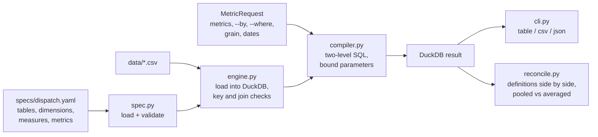

# Dispatch Metrics Layer

A small semantic layer for dispatch KPIs. On-time rate, OTIF, fill rate, cost per km and the rest are defined **once** in a YAML spec, and every request ("on-time rate by carrier, monthly, North and South only") is compiled into one DuckDB query from that definition. A `reconcile` command puts competing definitions of the same KPI side by side, so a disagreement between two reports can be explained instead of argued about.

> All data in this project is synthetic, generated by `src/dispatch_metrics_layer/generator.py` with a fixed seed. The numbers below describe that synthetic data, not any real carrier.

## The problem

In most dispatch teams the on-time rate lives in several places: a Power BI measure, a SQL view, an Excel tab a planner keeps. Each one was written by a different person, so they quietly differ: one divides by delivered shipments, another by everything dispatched; one averages the per-carrier rates, another pools them. The monthly review then spends its time on "why does your number say 87.5% when mine says 89.1%" instead of on carriers.

The fix is to define each KPI once and make every report ask the same layer for it. This project builds that layer and the tooling around it:

- the spec is validated before anything runs (unknown columns, unsafe expressions, cycles in derived metrics),
- the data is checked before any query (duplicate shipment rows, join keys that would fan out, orphan keys),
- ratios are always computed as `SUM(numerator) / SUM(denominator)` at the requested grain,
- competing definitions can be compared on the same data with one command.

## How it works



The spec has four parts:

| Part | Example | Meaning |
|---|---|---|
| tables | `shipments` with joins to `carriers` and `lanes` (many-to-one) | the star schema; the fact table has a primary key and a time column |
| dimensions | `carrier: carriers.carrier_name` | what you can group or filter by |
| measures | `on_time_shipments: count where status = 'delivered' AND delivered_date <= promised_date` | one aggregate over fact rows |
| metrics | `on_time_rate = on_time_shipments / delivered_shipments` | what reports ask for: `simple`, `ratio` or `derived` (`late_rate = 1 - on_time_rate`) |

The compiler builds one query with two levels. The inner level makes a single pass over the fact table, joining only the dimension tables the request needs, and computes every required measure at the requested grain. The outer level turns measures into metrics. Filter values are bound as parameters, and every identifier from the spec is quoted. `--sql` shows the result:

```
$ dispatch-metrics query -m on_time_rate,cost_per_km --by region --where "mode != PARCEL" --sql
WITH agg AS (
  SELECT
    j_lanes."region" AS "region",
    COUNT(*) FILTER (WHERE f."status" = 'delivered' AND f."delivered_date" <= f."promised_date") AS "ms__on_time_shipments",
    COUNT(*) FILTER (WHERE f."status" = 'delivered') AS "ms__delivered_shipments",
    COALESCE(SUM(f."freight_cost") FILTER (WHERE f."status" <> 'cancelled'), 0) AS "ms__freight_cost",
    COALESCE(SUM(f."distance_km") FILTER (WHERE f."status" <> 'cancelled'), 0) AS "ms__planned_km"
  FROM "shipments" AS f
  LEFT JOIN "carriers" AS j_carriers ON f."carrier_id" = j_carriers."carrier_id"
  LEFT JOIN "lanes" AS j_lanes ON f."lane_id" = j_lanes."lane_id"
  WHERE j_carriers."mode" IS DISTINCT FROM ?
  GROUP BY 1
)
SELECT "region", CAST("ms__on_time_shipments" AS DOUBLE) / NULLIF("ms__delivered_shipments", 0) AS "on_time_rate", CAST("ms__freight_cost" AS DOUBLE) / NULLIF("ms__planned_km", 0) AS "cost_per_km"
FROM agg
ORDER BY "region" NULLS LAST
-- params: ['PARCEL']
```

## How to run it

```bash
cd projects/dispatch-metrics-layer
python -m venv .venv && source .venv/bin/activate
pip install -e ".[dev]"
pytest -q

dispatch-metrics generate --out data          # optional: the CSVs are already in data/
dispatch-metrics check                        # validate the spec against the data
dispatch-metrics list                         # metrics and dimensions
dispatch-metrics query -m shipment_count,on_time_rate,otif_rate,cost_per_km --by carrier
dispatch-metrics reconcile -m on_time_rate,on_time_rate_dispatched,on_time_rate_units --by carrier
```

`query` options: `--by` (comma-separated dimensions), repeatable `--where` (`=`, `!=`, `<`, `<=`, `>`, `>=`, `in`, `not_in`, e.g. `"region in North,South"`), `--grain day|week|month`, `--start` (inclusive) and `--end` (exclusive), `--format table|csv|json`, and `--sql`. `reconcile` takes the same filters and dates and one `--by` dimension; the first metric is the baseline. Exit codes: 0 success, 1 invalid spec or data, 2 invalid request.

## Results

All output below is from the bundled data (4,000 shipments dispatched 6 Jul to 27 Sep 2026, 6 carriers, 12 lanes), copied from a run of the commands above.

```
$ dispatch-metrics check
shipments: 4,000 rows
carriers: 6 rows
lanes: 12 rows
spec OK: 14 metrics, 6 dimensions, 13 measures

$ dispatch-metrics query -m shipment_count,on_time_rate,otif_rate,cost_per_km --by carrier
carrier            shipment_count  on_time_rate  otif_rate  cost_per_km
-----------------  --------------  ------------  ---------  -----------
Coastal Express               655         84.5%      80.4%        18.47
Deccan Carriers               665         91.9%      87.9%        28.68
Ganga Logistics               684         79.0%      74.7%        28.76
Metro Parcel                  650         96.5%      90.0%        18.58
Northline Freight             669         93.6%      89.0%        42.98
Swift Roadways                677         89.6%      82.8%        43.08
```

### Reconciling three on-time definitions

```
$ dispatch-metrics reconcile -m on_time_rate,on_time_rate_dispatched,on_time_rate_units,otif_rate --by carrier
Overall
definition               value  vs on_time_rate
-----------------------  -----  ---------------
on_time_rate             89.1%         baseline
on_time_rate_dispatched  87.5%         -1.6 pts
on_time_rate_units       89.4%         +0.3 pts
otif_rate                84.1%         -5.0 pts
baseline: Share of delivered shipments that arrived on or before the promised date
spread across definitions: 5.3 pts

By carrier
carrier            on_time_rate  on_time_rate_dispatched  on_time_rate_units  otif_rate
-----------------  ------------  -----------------------  ------------------  ---------
Coastal Express           84.5%                    82.5%               85.6%      80.4%
Deccan Carriers           91.9%                    90.8%               91.5%      87.9%
Ganga Logistics           79.0%                    77.4%               79.4%      74.7%
Metro Parcel              96.5%                    94.5%               96.2%      90.0%
Northline Freight         93.6%                    92.3%               93.6%      89.0%
Swift Roadways            89.6%                    87.8%               89.9%      82.8%

Pooled rate vs unweighted average of carrier rates
metric                   pooled  avg of groups       gap
-----------------------  ------  -------------  --------
on_time_rate              89.1%          89.2%  +0.0 pts
on_time_rate_dispatched   87.5%          87.5%  +0.1 pts
on_time_rate_units        89.4%          89.4%  +0.0 pts
otif_rate                 84.1%          84.1%  +0.0 pts
```

What this shows:

- **The denominator matters most at the edge of the data.** Over the whole period, dividing by dispatched instead of delivered shipments costs 1.6 points, because 71 shipments are still in transit. Restricted to the last week, every one of those 71 is in the denominator but none can be in the numerator yet:

  ```
  $ dispatch-metrics reconcile -m on_time_rate,on_time_rate_dispatched,on_time_rate_units --start 2026-09-21
  Overall
  definition               value  vs on_time_rate
  -----------------------  -----  ---------------
  on_time_rate             96.4%         baseline
  on_time_rate_dispatched  73.1%        -23.3 pts
  on_time_rate_units       96.7%         +0.2 pts
  baseline: Share of delivered shipments that arrived on or before the promised date
  spread across definitions: 23.5 pts
  ```

  Neither number is right for the latest week. The delivered-based rate (96.4%) only sees the shipments that arrived quickly, and the dispatched-based rate (73.1%) counts unfinished shipments as failures. A weekly report should either wait until the week's shipments have closed or show the in-transit count next to the rate.
- **Weighting by units barely moves the number here** (+0.3 points overall), because the generator does not make late delivery depend on shipment size. On real data, where large FTL loads and small parcels behave differently, this gap can be much bigger; the command is how you would find out.
- **Pooled vs averaged rates agree on this data** (gap of 0.4 points or less by carrier, region, mode, origin or destination), because the synthetic carriers have similar volumes (650 to 684 shipments each). The check is there for real data, where one carrier with 50 shipments and one with 5,000 would make the unweighted average misleading. The layer always serves the pooled value.

### Data checks that caught real problems during the review

- A re-delivered extract with 49 repeated shipment rows turned 4,000 shipments into 4,049 and inflated every count and sum. The engine now refuses to answer and names the repeated keys (`DuplicateKeyError`).
- A duplicated `lane_id` in the lanes table would double every matching shipment's freight cost through the join. It is a hard error (`FanOutError`).
- A `!=` or `not_in` filter used to drop shipments whose carrier or lane had no match (NULL dimension), so `mode = PARCEL` plus `mode != PARCEL` did not add up to the total. Both now keep those rows.

**Tests:** 93 passed. Every metric is checked against an independent pandas calculation, overall, by carrier, by mode, by region and by week, including the derived metrics and each reconcile definition.

## Design decisions

- **Ratios are a ratio of sums, never an average of ratios.** It is the only definition that stays consistent when you change the grouping. `reconcile` shows the alternative so the difference is visible rather than hidden.
- **Measures carry their own filters** (`COUNT(*) FILTER (WHERE ...)`) instead of the query having a single WHERE, so `on_time_rate` and `cancellation_rate` can be computed in the same pass even though one excludes cancelled shipments and the other counts them.
- **Derived metrics are expanded into SQL, not computed in Python.** `late_rate = 1 - on_time_rate` is evaluated from measures at the requested grain, and a result that is not a finite number (division by zero) comes back as NULL.
- **Expressions are restricted.** Measure expressions and filters may only reference fact-table columns and a small set of SQL keywords and functions; anything else, including `;` and comments, is rejected when the spec loads, not when a report runs.
- **Joins are many-to-one and checked.** Only the dimension tables a request needs are joined, and the engine proves each join key is unique before the first query. Orphan keys are reported by `check` and appear under an empty dimension value; they still count in totals. In the Python API, a filter value of `None` selects them (`Filter("carrier", "=", None)`, or `None` inside an `in` / `not_in` list), so a filter on the empty group returns the same rows the grouped result shows there.
- **DuckDB in memory over CSVs** keeps the project runnable with no server. The compiler only emits standard SQL plus `FILTER` and `date_trunc`, so pointing the engine at a warehouse is a connection change, not a rewrite.

## Limitations

- **Partial periods.** `--grain` truncates the dispatch date to the start of the day, week (Monday) or month. If the data or `--start` begins mid-period, the first period only covers part of it; the bundled data starts on Monday 6 July, so July in a monthly view has 26 days of shipments, and September ends on the 27th. Compare partial periods with care or pass period-aligned `--start` and `--end` dates.
- Only one fact table per spec, and only many-to-one joins from it.
- The time grain always uses the fact table's time column (dispatch date). A delivery-date view of the same KPIs would need a second spec or a second time column option.
- `--where` values are passed as strings and cast by DuckDB, so numeric dimensions compare as numbers only when the column is numeric in the data.
