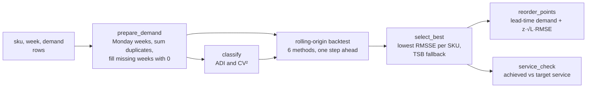

# Intermittent Demand Forecaster

Forecasts weekly demand for spare parts and other slow-moving SKUs, picks the best forecasting method for each SKU by backtesting, and turns the result into a reorder point at a target service level.

## The problem

In a spare-parts or MRO store most SKUs do not sell every week. A part might move 0, 0, 3, 0, 0, 0, 12, 0 units. Standard forecasting tools treat those zeros badly: a moving average or exponential smoothing chases each spike, and error metrics based on absolute error reward forecasting zero, which leaves the shelf empty when the order finally comes. Stock planners then set reorder points by hand, usually too high for slow parts and too low for lumpy ones.

The usual fix in practice is to:

1. classify each SKU's demand pattern (smooth, erratic, intermittent, lumpy),
2. use methods built for sparse demand (Croston, SBA, TSB) next to the standard ones,
3. let a backtest decide which method fits each SKU,
4. size safety stock from how wrong that method actually was.

This project does those four steps end to end and then checks how often the resulting reorder points would have held up.

## How it works



1. **Prepare** (`prepare.py`). Order extracts usually hold only weeks with orders, sometimes several rows per week. Dates are moved to the Monday of their week, duplicates are summed, and every week from a SKU's first row to the last week in the data is filled in with zero. Trailing zeros are kept on purpose: a part that stopped selling has to look like one.
2. **Classify** (`classify.py`). ADI (average interval between demands) and CV² (variability of the non-zero order sizes) with the Syntetos-Boylan-Croston cut-offs of 1.32 and 0.49.
3. **Forecast** (`methods.py`). Naive, 4-week moving average, simple exponential smoothing, Croston, SBA (Croston with its bias correction) and TSB (which smooths the probability of demand every week, so it decays for parts going obsolete). All one-step-ahead, written with numpy, smoothing constant 0.1.
4. **Backtest and select** (`backtest.py`). For the last 26 weeks each method forecasts week t using only weeks before t. Errors are scaled by the naive error on the training part (MASE, RMSSE) so SKUs of very different volume can be compared. The class used in the results is computed on the training part only. The method with the lowest RMSSE wins; SKUs where no method can be scored (no demand or flat demand in training) get TSB, and the `selected_by` column says so.
5. **Reorder point** (`reorder.py`). Lead-time demand is the selected forecast times the lead time. Safety stock is z(service level) × √(lead time) × backtest RMSE of the selected method. The reorder point is the sum, rounded up.
6. **Service check** (`reorder.py`). For every week in the holdout that still has a full lead time after it, the reorder point is rebuilt from data before that week and compared with the actual demand over the next lead time. The share of windows covered is the achieved service level.

## How to run

```bash
cd projects/intermittent-demand-forecaster
python -m venv .venv && source .venv/bin/activate
pip install -e ".[dev]"
pytest -q

# synthetic data (the shipped sample was made with these defaults)
intermittent-demand generate --out data/sample_demand.csv

# score every method on every SKU
intermittent-demand backtest --input data/sample_demand.csv --out out/backtest.csv

# reorder points at a 4-week lead time and 95% service level
intermittent-demand reorder --input data/sample_demand.csv --lead-time 4 --service-level 0.95 --out out/reorder.csv
```

Input is any CSV with the columns `sku`, `week` and `demand` (extra columns are ignored). `--holdout` sets the number of weeks scored (default 26). The CLI returns exit code 2 with a message on bad input: missing columns or values, demand that is negative, infinite or not a number, or a week that is not a date. The message names up to three offending values and their rows.

## Results

From a run on the shipped sample: 40 SKUs, 104 weeks, 10 generated with each pattern. The classifier put all 40 SKUs in the class they were generated with.

Mean RMSSE by demand class, 26-week holdout (lower is better):

```
method        croston  moving_average  naive    sba    ses    tsb
demand_class
erratic         0.800           0.862  1.115  0.797  0.800  0.799
intermittent    0.640           0.679  0.801  0.635  0.632  0.631
lumpy           0.441           0.484  0.625  0.438  0.438  0.440
smooth          0.697           0.750  0.960  0.708  0.698  0.698
```

Method selected per SKU:

```
method        croston  moving_average  naive  sba  ses  tsb
demand_class
erratic             0               1      0    5    0    4
intermittent        0               1      1    6    1    1
lumpy               1               0      0    5    2    2
smooth              3               1      0    0    1    5
```

Reorder points at a 4-week lead time and 95% target service level, summed per class:

```
              skus  lead_time_demand  safety_stock  reorder_point  achieved_service
demand_class
erratic         10             729.0         760.1           1494             0.930
intermittent    10              57.8          86.3            149             0.930
lumpy           10              47.9          93.2            144             0.939
smooth          10             758.9         208.6            973             0.948
```

What this says:

- On intermittent and lumpy SKUs naive is clearly worst (RMSSE 0.801 and 0.625) and SBA, SES and TSB are close to each other. The gap between the sparse-demand methods is small on this data, which is why selection is done per SKU rather than by class.
- Safety stock is large compared with lead-time demand for erratic, intermittent and lumpy parts. That is the real cost of variable demand, not a bug.
- Achieved service is 0.948 on smooth SKUs, almost exactly the 95% target, and 0.930 to 0.939 on the other classes. The normal approximation and the √L step under-cover sparse and erratic demand slightly, and this check is already optimistic because the RMSE comes from the same holdout. For a real store, raising the target a little for those classes, or moving to an empirical quantile of lead-time demand, would be the next step.

Test suite: 91 tests, including hand-computed checks for every smoothing method, input validation for every method and for the input file, a no-lookahead check on the backtest and the service check, and the edge cases found in review (missing weeks, duplicate rows, SKUs that cannot be scored).

## Design decisions

- **RMSSE for selection, not MASE.** On sparse series the median weekly demand is often zero, and absolute-error metrics reward a zero forecast. Squared error targets the mean, which is what stocking needs.
- **Safety stock from backtest error, not raw demand variance.** It ties the buffer to how wrong the chosen method actually was.
- **TSB as fallback.** For a SKU with no scorable history, TSB decays towards zero when demand stops, so a dead part does not keep its stock.
- **Plain numpy methods.** Six short functions are easier to check by hand than a library call, and the tests do exactly that.
- **Out of scope:** optimised smoothing constants, multi-step or probabilistic forecasts, order quantities, supplier lead-time variability.

## Data

All data is synthetic. `generate.py` draws each week as "does any order arrive" (Bernoulli) times an order size (normal for stable sizes, lognormal for variable ones), seeded and reproducible. No real company data is used.
