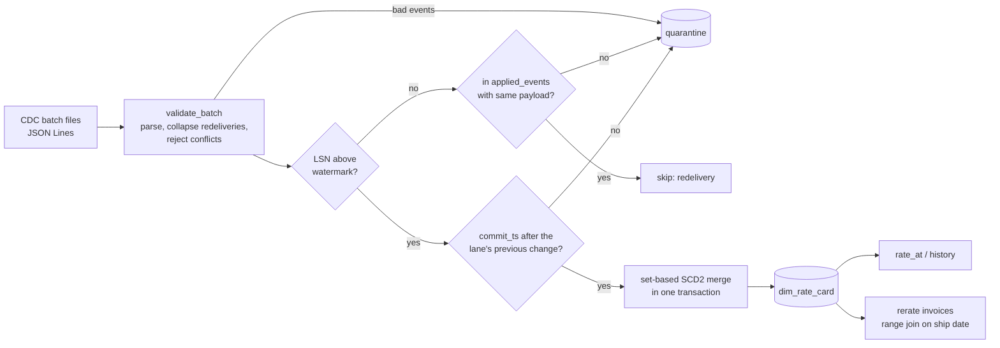

# Rate Card History Loader

Loads change data capture (CDC) events from a carrier rate table into a Slowly Changing Dimension Type 2 table in DuckDB, so you can look up the rate that was valid on any past date. It then uses that history to re-rate carrier invoices against the rate in force on the ship date.

All data in this project is synthetic. It is generated from a fixed seed by the code in `src/`, and no real carrier, lane or invoice is used.

## The problem

A freight audit team checks carrier invoices against contracted rates. The rate table in the transport system only holds today's rates, but an invoice for a shipment that moved six weeks ago has to be checked against the rate that applied six weeks ago. If the rate changed in between, comparing against today's rate flags correct invoices and misses wrong ones.

The changes to the rate table are available as a CDC stream (one event per insert, update or delete, Debezium style). Turning that stream into a reliable history is harder than it looks, because CDC delivery is at-least-once:

- events arrive out of order inside a batch
- some events are delivered twice, sometimes in the next batch
- a whole batch can be replayed after a failure
- the source sometimes "updates" a row without changing any value
- a few events are malformed

The loader has to produce the same history whatever happens to the delivery, and make anything it cannot apply visible instead of dropping it silently.

## How it works



1. **Validation** (`validation.py`). Each record is parsed into a `ChangeEvent`. Missing fields, bad types, non-positive rates, NaN or infinite numbers, timestamps with an offset and non-ISO currency codes are rejected with a reason. An exact redelivery inside a batch is collapsed to one event; two different payloads under the same LSN are both rejected, because they cannot both be right.
2. **Watermark and ledger** (`loader.py`). The loader keeps the highest LSN it has seen and an `applied_events` ledger of every LSN it applied with a hash of its payload. An event at or below the watermark is skipped if it matches the ledger exactly (a redelivery or replay). If its LSN was never applied (a late event) or was applied with a different payload, it goes to quarantine.
3. **Commit order check**. LSN order is the source's order of changes. An event with a later LSN but an earlier commit time than the lane's previous change would close the open version before it started, so it is quarantined. Two changes to one lane at the same instant keep only the highest LSN, since only the final state was ever visible.
4. **SCD Type 2 merge**. The merge is set-based SQL with window functions, so a batch with several changes to the same lane produces the full chain of versions in one pass. Changes that do not alter any tracked value are counted as no-ops and do not open a version. A delete closes the open version and leaves the lane with no current row. Each batch is applied in one transaction together with its quarantine rows, ledger entries, watermark and `load_log` row.
5. **Lookups** (`lookup.py`). A version is valid from its commit time (inclusive) to the next change (exclusive). `rate_at` returns the version valid at a moment, or nothing if the lane did not exist or had been withdrawn.
6. **Re-rating** (`rerate.py`). All invoices are matched to their rate version in one range join, priced with the same `charge()` used by the lookup API (rate x weight, at least the minimum charge), and classed as `ok`, `overbilled`, `underbilled`, `no_rate` or `currency_mismatch`. Money totals are kept per currency.

## How to run it

Requires Python 3.10 or newer.

```bash
cd projects/rate-card-history-loader
python -m venv .venv && source .venv/bin/activate
pip install -e ".[dev]"
pytest -q

# Regenerate the synthetic data (the committed files in data/ come from the same default seed)
rate-card-history generate --out data

# Load every batch in file name order
rate-card-history load data/cdc_batches --db rates.duckdb

# Query the history
rate-card-history history L001-CCU-BLR --db rates.duckdb
rate-card-history rate-at L001-CCU-BLR 2026-07-15T10:00:00 --db rates.duckdb

# Re-rate the invoices and write the lines that need attention
rate-card-history rerate data/invoices.csv --db rates.duckdb --out report.csv
```

Timestamps are naive UTC (no offset), as the synthetic source publishes them.

## Results

From a run on 29 Oct 2026 on the committed sample data (6 batches, 259 true changes across 40 lanes over 120 days). `generate` with the default seed reproduces the committed files byte for byte.

Loading:

```
batch           recv  rej  dup  seen  no-op  open  close  wmark
batch_0001        63    0    3     0      4    54     15   1178
batch_0002        64    2    1     1     15    42     41   1340
batch_0003        64    0    4     0     11    44     46   1497
batch_0004        62    1    1     0     12    45     44   1663
batch_0005        25    1    2     3      2    16     15   1715
batch_0006        64    2    1    61      0     0      0   1715
dim_rate_card: 201 versions, 40 current lanes; quarantine: 6 rows
```

- `batch_0006` is a replay of `batch_0002`. It opens and closes nothing: 61 events are recognised as already applied, 1 as an in-batch duplicate, and the 2 malformed events are quarantined again.
- The 6 quarantine rows are the 4 planted malformed events (a negative rate, an unknown op, a missing commit time, currency "rupees"); two of them sit in the replayed batch. No real change is quarantined.
- 44 events were counted as no-ops and opened no version: they changed no tracked value, or were superseded by a later change to the same lane at the same instant.

One lane's history:

```
2026-06-01T00:51:00  ->  2026-06-28T11:37:00     7.16/kg  min 250.00
2026-06-28T11:37:00  ->  2026-07-15T09:05:00     7.24/kg  min 600.00
2026-07-15T09:05:00  ->  2026-08-01T10:20:00     7.79/kg  min 600.00
2026-08-01T10:20:00  ->  open                    7.33/kg  min 600.00
```

Re-rating 400 synthetic invoices:

```
invoices: 400 valid, 0 invalid
  ok                  379
  overbilled            6
  underbilled           2
  no_rate              13
  currency_mismatch     0
INR overbilled total:  1586.50
INR underbilled total: 172.24
INR billed with no contracted rate: 44082.84
```

The invoice generator plants two kinds of error: billing at the rate valid on the invoice date instead of the ship date (`stale_rate`, which shows up as over- or underbilling depending on the direction of the rate change), and billing a lane that had been withdrawn (`no_contract`). The report finds every planted error and flags nothing else; `test_report_finds_every_planted_billing_error_in_the_synthetic_data` checks this against the generator's ground truth, which the report itself never reads.

Tests: 83 passed. The end-to-end tests load the full shuffled, duplicated and replayed stream and compare the dimension with the true history: current rates match the true final state, more than 1,000 point-in-time lookups match, no lane has overlapping or zero-length versions, and the replay is a no-op.

## Design decisions

- **LSN watermark plus a ledger, not the watermark alone.** A watermark makes replays cheap to skip, but on its own it cannot tell a replay from a late event that was never applied. The ledger keeps that difference visible.
- **Quarantine instead of failing the batch.** One bad event from the source should not block every valid rate change behind it. Every reject is stored with its batch, LSN, reason and the raw record.
- **Valid-from inclusive, valid-to exclusive.** A shipment at the exact moment of a rate change gets the new rate, and every moment belongs to exactly one version.
- **No-op updates do not open versions.** The row hash covers only the tracked attributes, so touching a row without changing it does not split the history.
- **Totals per currency.** Overbilled and underbilled amounts are never added across currencies; the single-number totals refuse to answer when a report mixes them.
- **DuckDB in-process.** The whole pipeline runs offline on a laptop; the SQL is plain enough to move to a warehouse.

## Limitations

- The loader expects batches to be loaded in file name order. A batch that arrives far out of order shows up as late events in quarantine rather than being merged into the past.
- Corrections to history (back-dated rate changes) are out of scope: the dimension records when a change was committed, not a business effective date.
- Timestamps are treated as naive UTC; time zone handling is left to the source.
