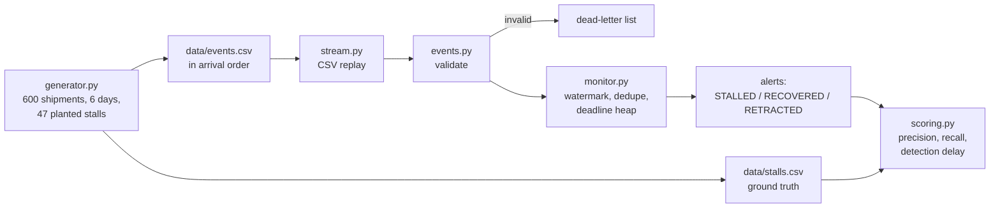

# Stalled Shipment Stream Monitor

Flags shipments that have stopped sending tracking scans, from a carrier event stream that arrives out of order, hours late and with duplicates. It works in event time with a watermark, so a scan that was uploaded late does not trigger a false "stalled" alert, and it measures what that tolerance costs in detection delay.

> All data in this project is synthetic, generated by `src/stalled_shipment_stream_monitor/generator.py` with a fixed seed. The numbers below describe that synthetic stream, not any real carrier.

## The problem

A control tower wants to know, as early as possible, which shipments have gone quiet: a parcel sitting at a hub for 14 hours with no scan usually means it was missorted, left on a dock or lost. The obvious rule, "no scan in the last N hours", breaks on real carrier feeds:

- handheld scanners batch-upload, so a scan made at 10:00 can arrive at 13:00, after the shipment already looked stalled;
- the same message is delivered twice;
- scans arrive in a different order from the one they happened in;
- some rows are malformed (no timezone, unknown event type, blank shipment ID).

Checking against wall-clock time raises false alerts for every late upload. Waiting longer for late data removes them but delays every true alert. This project makes that trade-off explicit and measurable.

## How it works



- **Event time and watermark.** The monitor never looks at the clock. The watermark is the largest event time seen so far minus the allowed lateness; the monitor assumes every scan up to the watermark has arrived. A shipment is stalled when the watermark is past its latest scan by more than the threshold for its stage (8 h after pickup, 12 h at a hub, 14 h in transit, 8 h out for delivery).
- **Deadline heap.** Each scan pushes the shipment's deadline onto a min-heap, so an event costs O(log n) instead of a pass over every open shipment. Entries carry a version, and superseded ones are skipped when popped.
- **Duplicates and out-of-order scans.** Event IDs are deduplicated per shipment. An older scan arriving after a newer one is recorded but does not move the shipment back a stage.
- **Three alert kinds.** `STALLED` when the deadline passes. When a newer scan arrives for a stalled shipment, the alert is `RECOVERED` if the gap really was longer than the threshold, or `RETRACTED` if a late upload shows it never was, so false alarms can be told apart from real stalls that cleared.
- **Bounded state.** Delivered shipments are released once the watermark is `state_retention` (24 h) past their last scan, and any event older than that is dead-lettered as too late, so a very late duplicate cannot re-open a closed shipment.
- **Dead letters.** Invalid rows go to a dead-letter list with a reason instead of stopping the replay. A stall alert carries the number of dead-lettered scans for that shipment, because the "missing" scan is often sitting there.

The generator writes the stream in arrival order: most scans arrive within 20 minutes, 10% arrive 1 to 4 hours late in a batch, 3% are delivered twice and 0.5% are malformed. 8% of shipments get one planted stall of 24 to 72 hours; some resume, the rest go silent until the end of the window.

## How to run it

```bash
cd projects/stalled-shipment-stream-monitor
python -m venv .venv && source .venv/bin/activate
pip install -e ".[dev]"
pytest -q
mypy                                                  # strict type check of src/

stall-monitor generate --out data                     # optional: the CSVs are already in data/
stall-monitor run data/events.csv --alerts-out alerts.csv
stall-monitor run data/events.csv --lateness 0        # no tolerance for late scans
stall-monitor score data/events.csv data/stalls.csv   # sweep allowed lateness 0, 2, 4, 6 h
```

`run` options: `--lateness` (hours, default 4), `--retention` (hours, default 24), `--alerts-out` (CSV with every alert). `score` takes `--lateness` with one or more values. Bad arguments (negative, zero retention, `inf`, `nan`, non-numbers) are rejected by the parser; a missing file exits with code 2 and an error message.

## Results

Sample stream: 3,607 rows for 600 shipments over 6 days, 47 planted stalls (10 resume, 37 go silent).

`stall-monitor run data/events.csv` (4 h allowed lateness):

```
events: 3473 accepted, 105 duplicates, 29 invalid, 0 too late, 55 out of order
alerts: 49 stalled, 10 recovered, 0 retracted
open stalls at end of stream: 39
shipments held in state: 162 (438 delivered and released)
stall alerts with dead-lettered scans (check the dead-letter list first): SHP00084, SHP00125, SHP00174
```

The 29 invalid rows are 10 unknown event types, 10 timestamps without a timezone offset and 9 blank shipment IDs. The same stream with `--lateness 0` raises 58 stall alerts, 4 of which are later retracted by a late upload.

`stall-monitor score data/events.csv data/stalls.csv`:

| lateness_h | alerts | false | retracted | dead_letter | unexplained | precision | recall | due | not_due | median_delay_h | p90_delay_h |
|---|---|---|---|---|---|---|---|---|---|---|---|
| 0 | 58 | 11 | 4 | 5 | 3 | 0.810 | 1.000 | 47 | 0 | 0.1 | 0.3 |
| 2 | 52 | 5 | 0 | 3 | 2 | 0.904 | 1.000 | 47 | 0 | 2.1 | 2.2 |
| 4 | 49 | 4 | 0 | 2 | 2 | 0.918 | 1.000 | 45 | 2 | 4.2 | 4.3 |
| 6 | 49 | 4 | 0 | 2 | 2 | 0.918 | 1.000 | 44 | 3 | 6.2 | 6.3 |

What the table says:

- Every planted stall that could be confirmed before the stream ended is caught at every setting (recall 1.000).
- Two hours of allowed lateness removes every false alert caused by late uploads (retracted drops from 4 to 0). Each extra hour after that only adds an hour of detection delay.
- All false alerts left at 2 h and above come from malformed scans: the shipment's next scan was dead-lettered, so it really did look silent. Two of them are tied to the shipment (`dead_letter`); the other two (`unexplained`) lost their `DELIVERED` scan to a blank shipment ID, which cannot be tied to any shipment. The 3 unexplained at 0 h are the same kind of case.
- `due` falls as lateness grows: a stall that starts close to the end of the window cannot be confirmed before the watermark runs out. Those stalls are reported as `not_due` and left out of recall.

The late upload delay in the generator tops out at 4 hours, which is why the `late` counter is 0 at 4 h. On a real feed the allowed lateness would be picked from the observed distribution of ingest delay minus event time.

Tests: 79 passed, covering validation, the watermark and threshold logic, retractions, eviction, dead-letter attribution, scoring, the CLI and an end-to-end replay that checks the committed sample data matches the generator.

## Design decisions

- **Event time only.** Replaying the same file always gives the same alerts, which makes the monitor testable and lets the lateness setting be scored offline before it is used on a live feed.
- **One watermark for the whole stream, not per carrier.** Simple and correct for one feed. A feed that mixes carriers with very different upload habits would need a watermark per source, otherwise the slowest one sets the delay for everyone.
- **Retract instead of suppress.** Raising `STALLED` and later `RETRACTED` keeps alerts fast and honest; the score shows how often that happens at each lateness, so the setting can be chosen on data.
- **Scoring by shipment.** One planted stall per shipment, matched to the first `STALLED` alert for it. On the sample one true stall (SHP00084) is flagged from the scan before the planted one, because the planted scan itself was malformed; it is still counted as caught, since the shipment really was stalled.
- **Standard library only.** The monitor is a few hundred lines of Python with a heap and dictionaries; no stream framework is needed to show the logic, and the same rules map directly onto Flink or Spark Structured Streaming watermarks.

## Layout

```
src/stalled_shipment_stream_monitor/
  events.py     typed event, validation with a reason per rejection
  generator.py  synthetic stream and ground truth
  monitor.py    watermark, dedupe, deadline heap, alerts, eviction
  stream.py     CSV replay in arrival order
  scoring.py    precision, recall over due stalls, detection delay, lateness sweep
  cli.py        stall-monitor generate | run | score
data/           sample stream (events.csv) and planted stalls (stalls.csv)
tests/          79 tests
```
